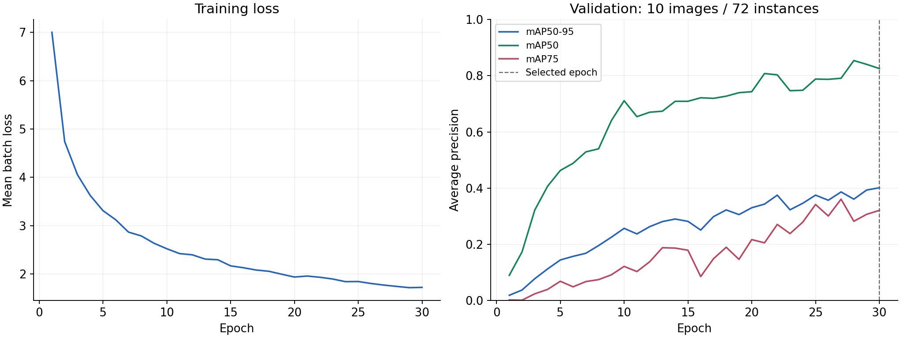

# Fruit Detection with a Multi-Scale ResNet Detector

An object detection experiment for apples, bananas, oranges, and pears. A pretrained ResNet-18 backbone feeds two prediction heads that produce bounding boxes, class scores, and objectness scores at different feature-map resolutions.

## Results

A complete 30-epoch CPU run reached the following scores at epoch 30, selected by validation mAP50-95:

| Validation metric | Score |
| --- | ---: |
| mAP50-95 | 40.1% |
| mAP50 | 82.5% |
| mAP75 | 32.1% |

Training used 218 images and evaluation used 10 images with 72 annotated objects. These are **validation model-selection scores, not independent test results**. Apples performed best; bananas, occlusion, and duplicate boxes remain weaknesses. All metrics above come from the same checkpoint.




Green dashed boxes are ground truth; magenta boxes are predictions. Display confidence is at least 0.30, while metric evaluation uses scores above 0.05. The [complete experiment report](results/seed42-cpu/README.md) includes all 10 validation images in dataset order, per-class scores, environment details, and limitations.

## Project Structure

```text
.
|-- fruit_detection_one_step.ipynb
|-- object_detection_utils.py
|-- experiment_report.py
|-- scripts/run_notebook.py
|-- tests/test_evaluation.py
|-- results/seed42-cpu/               # measured scores and validation figures
|-- README.md
|-- pyproject.toml
|-- uv.lock
|-- requirements.txt
`-- fruit-detection-challenge/        # local dataset folder, not included in Git
```

## Dataset

The original course dataset is not included in this repository. To run the notebook, provide your own dataset with the same COCO-style annotation format:

```text
fruit-detection-challenge/
  detection/
    annotations/
      train.json
      val.json
      val.txt
      test.json        # optional
    train/
    val/
  test/                # optional
```

Bounding boxes use COCO `[x, y, width, height]` pixel coordinates. The notebook converts them to normalized `[center_x, center_y, width, height]` boxes. Use the same category order in every split: apple, banana, orange, pear, with category IDs 1 through 4.

`val.txt` contains one ground-truth object per line, without a header:

```text
image_name,cx,cy,w,h,class_id
```

The values are normalized to the image dimensions. Inference adds a seventh field, `confidence`. An optional `test.json` can contain an empty `annotations` list alongside `images` and `categories`.

## Dependencies

This project requires Python 3.11 or newer.

Install [uv](https://docs.astral.sh/uv/getting-started/installation/) and Git, then run:

```bash
git clone https://github.com/benbenbeatit912002/Fruit-detection-project-.git
cd Fruit-detection-project-
uv sync --locked
uv run jupyter lab
```

Open the notebook with the project's `.venv` kernel. Jupyter and the evaluation backend are included. The first model initialization downloads the official TorchVision ResNet-18 weights. CPU execution is supported; the notebook uses CUDA when available in the installed PyTorch build.

The `pip` alternative installs the same direct dependencies, without the locked versions:

```bash
python -m venv .venv
.venv\Scripts\python -m pip install -r requirements.txt
```

## Running the Project

1. Add a compatible dataset under `fruit-detection-challenge/`.
2. Open `fruit_detection_one_step.ipynb`.
3. Run the notebook from top to bottom to train and evaluate the model.
4. The best validation checkpoint is reloaded for inference. Checkpoints and predictions are saved under `runs/latest/`.

For a complete run with saved metrics and PNG figures:

```bash
uv run python scripts/run_notebook.py --output runs/my-run
```

The runner checks the dataset, executes the notebook with the current Python interpreter, and saves an executed copy, per-epoch history, the best checkpoint, a JSON summary, training curves, per-class AP, and all validation examples. It refuses to overwrite an existing completed or partially executed run. Choose a new output directory for each experiment.

## Training Configuration

| Setting | Value |
| --- | --- |
| Backbone | Pretrained ResNet-18 |
| Prediction heads | 256-channel and 512-channel feature maps |
| Input size | 512 x 512 |
| Batch size / epochs | 4 / 30 |
| Random seed | 42 |
| Optimizer | AdamW, weight decay 0.0001 |
| Learning rates | Backbone: 0.00001; heads: 0.0001 |
| Scheduler | ReduceLROnPlateau on validation mAP |
| Loss | Cross-entropy + 5 x L1 + 5 x DIoU + 2 x objectness BCE |
| Matching | Hungarian assignment with class, L1, and GIoU costs |
| Augmentation | Scale jitter, crop/padding, horizontal flip, color adjustments |
| Evaluation thresholds | Confidence > 0.05; class-wise NMS IoU 0.70 |

## Evaluation

Evaluation uses TorchMetrics and pycocotools. `mAP50-95` averages AP across IoU thresholds from 0.50 to 0.95; `mAP50` and `mAP75` use individual thresholds. Images without detections remain in the evaluation, and predictions on background images count as false positives.

The supplied local split has 218 training images (1,603 objects) and 10 validation images (72 objects). Validation chooses the best epoch, so its score is a model-selection result, not an independent test score. A single run on this small split does not establish generalization to different cameras, scenes, or fruit varieties.

The runner verifies that the JSON and text validation annotations agree and that no exact image files overlap between training and validation. This does not rule out visually similar scenes across splits.

Run the evaluation regression tests with:

```bash
uv run python -m unittest discover -s tests -v
```

The evaluator now includes missed images and background false positives. Older scores from the previous evaluator are not directly comparable. Empty-target batches are handled without NaN losses, and a first checkpoint is saved even when initial mAP is zero. The model layers, loss weights, learning rates, augmentation ranges, and training duration remain the same.

## Notes

- Model checkpoints, generated predictions, executed notebooks, caches, and local datasets are ignored by Git.
- Validation photographs in the results report are reproduced with permission. The full dataset is not redistributed.
- The notebook is intended as a portfolio-friendly research prototype rather than a production training package.
