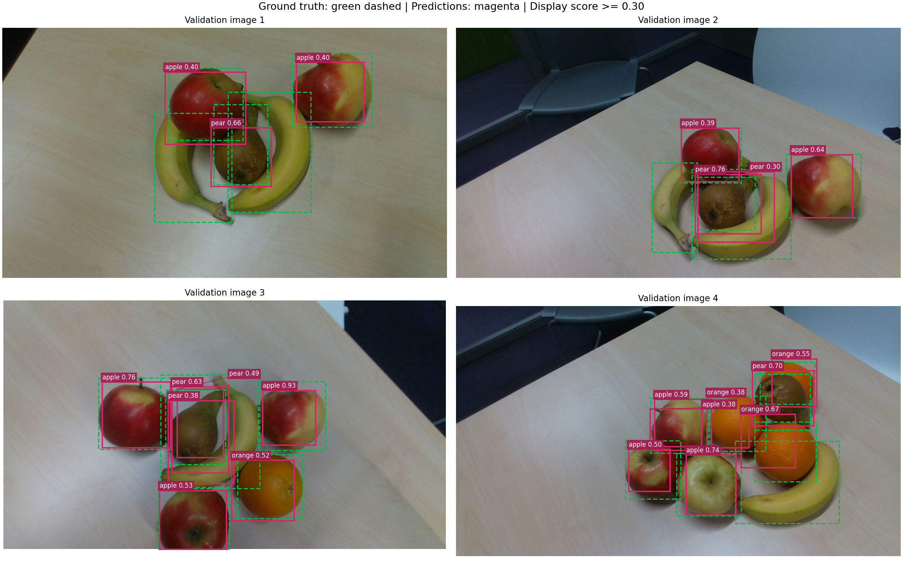

# Custom-Backbone Fruit Detector vs. YOLO11n

A four-class fruit detection study on a fixed course split. The primary experiment trains an original five-stage CNN with the project's dual-scale detection heads and an official Ultralytics YOLO11n from random initialization. The reference runs use an ImageNet-pretrained ResNet-18 and a COCO-pretrained YOLO11n. The GPU runs share a checkpoint-selection evaluator, pixel-coordinate postprocessing, and inference benchmark.

**[Read the English comparison report](results/seed42-gpu/README.md)** · [Measurements and all ten paired examples](results/seed42-gpu/measurements.md) · [Historical CPU report](results/seed42-cpu/README.md)

| Seed 42, 30 epochs | Custom CNN (scratch) | YOLO11n (scratch) | ResNet-18 (ImageNet) | YOLO11n (COCO) |
|---|---:|---:|---:|---:|
| Validation mAP50-95 | 22.4% | 83.4% | 56.7% | 96.5% |
| Median end-to-end latency, RTX 5070 Laptop GPU | 22.97 ms | 25.63 ms | 26.93 ms | 25.81 ms |

Scratch YOLO11n matched 70 of 72 labeled fruit at the display threshold, compared with 15 for the custom CNN. All four scores use the same ten images for checkpoint selection; no independent test score is claimed. Latency includes image decoding, preprocessing, the FP32 model and postprocessing at batch one.

## Reproduce the GPU comparison

Run from the repository root. The comparison has its own Windows x64, Python 3.11 uv project. The original notebook uses the root lockfile. The comparison lockfile pins both PyTorch wheel choices and the official Ultralytics implementation.

```powershell
# GPU environment used for the comparison
uv sync --project comparison --locked --python 3.11.15 --extra cu128
$py = ".\comparison\.venv\Scripts\python.exe"
& $py -m comparison.train smoke

# CPU option for conversion, analysis and tests
# uv sync --project comparison --locked --python 3.11.15 --extra cpu
```

The smoke test checks CUDA availability, matrix multiplication, TorchVision NMS, both dual-scale forward passes, loss and finite gradients. The measured environment used Torch 2.10.0 and TorchVision 0.25.0 with CUDA 12.8, on an RTX 5070 Laptop GPU with driver 581.42. The training entry point requires CUDA. [Official wheel pairs](https://pytorch.org/get-started/previous-versions/) · [NVIDIA CUDA 12.8 driver guidance](https://docs.nvidia.com/cuda/archive/12.8.1/cuda-toolkit-release-notes/index.html) · [uv PyTorch indexes](https://docs.astral.sh/uv/guides/integration/pytorch/)

Place the course `detection/train`, `detection/val`, and `detection/annotations/{train.json,val.json,val.txt}` under `fruit-detection-challenge/`. The preparation command audits the original split, checks its image and annotation fingerprints against the CPU run, writes YOLO text and a portable `data.yaml` under `datasets/fruit-yolo/`, and decodes every label again to verify coordinates and class IDs. It also saves a visual overlay pair in `conversion.jpg`. Use `--verify` to audit an existing conversion.

```powershell
& $py -m comparison.prepare
& $py -m unittest discover -s tests -v
curl.exe --fail --location --create-dirs https://download.pytorch.org/models/resnet18-f37072fd.pth --output weights/checkpoints/resnet18-f37072fd.pth
curl.exe --fail --location --create-dirs https://github.com/ultralytics/assets/releases/download/v8.3.0/yolo11n.pt --output weights/yolo11n.pt
& $py -m comparison.train resnet18-imagenet
& $py -m comparison.train custom-scratch
& $py -m comparison.train yolo11n-scratch
& $py -m comparison.train yolo11n-coco
& $py -m comparison.measure
& $py -m scripts.build_comparison_report --output runs/rebuilt-report
```

Each trainer requires a fresh output directory under `runs/gpu-seed42/` (or pass `--output`). Benchmark the four saved best checkpoints together with `comparison.measure --root <run-parent>` and rebuild figures with `scripts.build_comparison_report --input <run-parent>`. Checkpoints, images used for training, converted labels and the virtual environment are local. Report artifacts include the configurations, dataset fingerprints, source commits, software versions, per-epoch histories, verified validation predictions and raw latency samples.

To audit the published data fingerprints, selected epochs, latency samples and gallery coverage with Python alone, run `python -m unittest discover -s tests -p test_published_results.py -v`. This check runs without the course images, model weights or a GPU.

The dataset and starter detector are based on the Wageningen University ABE deep learning course. Validation-result photos are reproduced with permission. The YOLO experiments are an independent portfolio extension of that course work. Ultralytics publishes the YOLO11 implementation under AGPL-3.0 and offers a separate enterprise license. The ResNet-18 implementation and ImageNet weights are from TorchVision. The original project's detection heads, augmentation and Hungarian matcher are credited to the notebook and supporting code at `d48699f`. [Course challenge](https://git.wur.nl/abe-datasets/education/fruit-detection-challenge) · [Ultralytics YOLO11](https://docs.ultralytics.com/models/yolo11/) · [Ultralytics license](https://www.ultralytics.com/license) · [TorchVision ResNet-18](https://docs.pytorch.org/vision/stable/models/generated/torchvision.models.resnet18.html)

## Historical CPU results

A complete 30-epoch CPU run reached the following scores at epoch 30, selected by validation mAP50-95:

| Validation metric | Score |
| --- | ---: |
| mAP50-95 | 40.1% |
| mAP50 | 82.5% |
| mAP75 | 32.1% |

Training used 218 images and evaluation used 10 images with 72 annotated objects. These are **validation model-selection scores, not independent test results**. Apples performed best; bananas, occlusion, and duplicate boxes remain weaknesses. All metrics above come from the same checkpoint.




Green dashed boxes are ground truth; magenta boxes are predictions. Display confidence is at least 0.30, while metric evaluation uses scores above 0.05. The [complete experiment report](results/seed42-cpu/README.md) includes all 10 validation images in dataset order, per-class scores, environment details, and limitations.

## Notebook project structure

```text
.
|-- fruit_detection_one_step.ipynb
|-- object_detection_utils.py
|-- experiment_report.py
|-- scripts/run_notebook.py
|-- tests/test_evaluation.py
|-- results/seed42-cpu/               # measured scores and validation figures
|-- README.md
|-- pyproject.toml
|-- uv.lock
|-- requirements.txt
`-- fruit-detection-challenge/        # local dataset folder, not included in Git
```

## Dataset

The original course dataset is not included in this repository. To run the notebook, provide your own dataset with the same COCO-style annotation format:

```text
fruit-detection-challenge/
  detection/
    annotations/
      train.json
      val.json
      val.txt
      test.json        # optional
    train/
    val/
  test/                # optional
```

Bounding boxes use COCO `[x, y, width, height]` pixel coordinates. The notebook converts them to normalized `[center_x, center_y, width, height]` boxes. Use the same category order in every split: apple, banana, orange, pear, with category IDs 1 through 4.

`val.txt` contains one ground-truth object per line, without a header:

```text
image_name,cx,cy,w,h,class_id
```

The values are normalized to the image dimensions. Inference adds a seventh field, `confidence`. An optional `test.json` can contain an empty `annotations` list alongside `images` and `categories`.

## Original notebook environment

This project requires Python 3.11 or newer.

Install [uv](https://docs.astral.sh/uv/getting-started/installation/) and Git, then run:

```bash
git clone https://github.com/benbenbeatit912002/Fruit-detection-project-.git
cd Fruit-detection-project-
uv sync --locked
uv run jupyter lab
```

Open the notebook with the project's `.venv` kernel. Jupyter and the evaluation backend are included. The first model initialization downloads the official TorchVision ResNet-18 weights. CPU execution is supported; the notebook uses CUDA when available in the installed PyTorch build.

The `pip` alternative installs the same direct dependencies, without the locked versions:

```bash
python -m venv .venv
.venv\Scripts\python -m pip install -r requirements.txt
```

## Running the Project

1. Add a compatible dataset under `fruit-detection-challenge/`.
2. Open `fruit_detection_one_step.ipynb`.
3. Run the notebook from top to bottom to train and evaluate the model.
4. The best validation checkpoint is reloaded for inference. Checkpoints and predictions are saved under `runs/latest/`.

For a complete run with saved metrics and PNG figures:

```bash
uv run python scripts/run_notebook.py --output runs/my-run
```

The runner checks the dataset, executes the notebook with the current Python interpreter, and saves an executed copy, per-epoch history, the best checkpoint, a JSON summary, training curves, per-class AP, and all validation examples. It refuses to overwrite an existing completed or partially executed run. Choose a new output directory for each experiment.

## Training Configuration

| Setting | Value |
| --- | --- |
| Backbone | Pretrained ResNet-18 |
| Prediction heads | 256-channel and 512-channel feature maps |
| Input size | 512 x 512 |
| Batch size / epochs | 4 / 30 |
| Random seed | 42 |
| Optimizer | AdamW, weight decay 0.0001 |
| Learning rates | Backbone: 0.00001; heads: 0.0001 |
| Scheduler | ReduceLROnPlateau on validation mAP |
| Loss | Cross-entropy + 5 x L1 + 5 x DIoU + 2 x objectness BCE |
| Matching | Hungarian assignment with class, L1, and GIoU costs |
| Augmentation | Scale jitter, crop/padding, horizontal flip, color adjustments |
| Evaluation thresholds | Confidence > 0.05; class-wise NMS IoU 0.70 |

## Evaluation

Evaluation uses TorchMetrics and pycocotools. `mAP50-95` averages AP across IoU thresholds from 0.50 to 0.95; `mAP50` and `mAP75` use individual thresholds. Images without detections remain in the evaluation, and predictions on background images count as false positives.

The supplied local split has 218 training images (1,603 objects) and 10 validation images (72 objects). Validation chooses the best epoch, so its score is a model-selection result, not an independent test score. A single run on this small split does not establish generalization to different cameras, scenes, or fruit varieties.

The runner verifies that the JSON and text validation annotations agree and that no exact image files overlap between training and validation. This does not rule out visually similar scenes across splits.

Run the historical evaluator regression tests in the original notebook environment with:

```bash
uv run python -m unittest discover -s tests -p test_evaluation.py -v
```

The evaluator now includes missed images and background false positives. Older scores from the previous evaluator are not directly comparable. Empty-target batches are handled without NaN losses, and a first checkpoint is saved even when initial mAP is zero. The model layers, loss weights, learning rates, augmentation ranges, and training duration remain the same.

## Notes

- Model checkpoints, generated predictions, executed notebooks, caches, and local datasets are ignored by Git.
- Validation photographs in the results report are reproduced with permission. The full dataset is not redistributed.
- The notebook is intended as a portfolio-friendly research prototype rather than a production training package.
