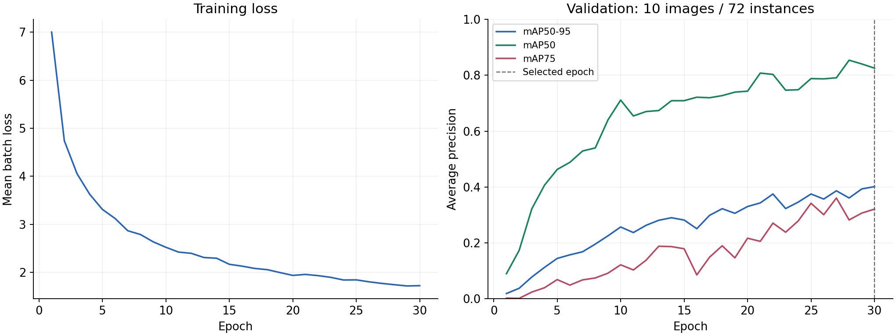
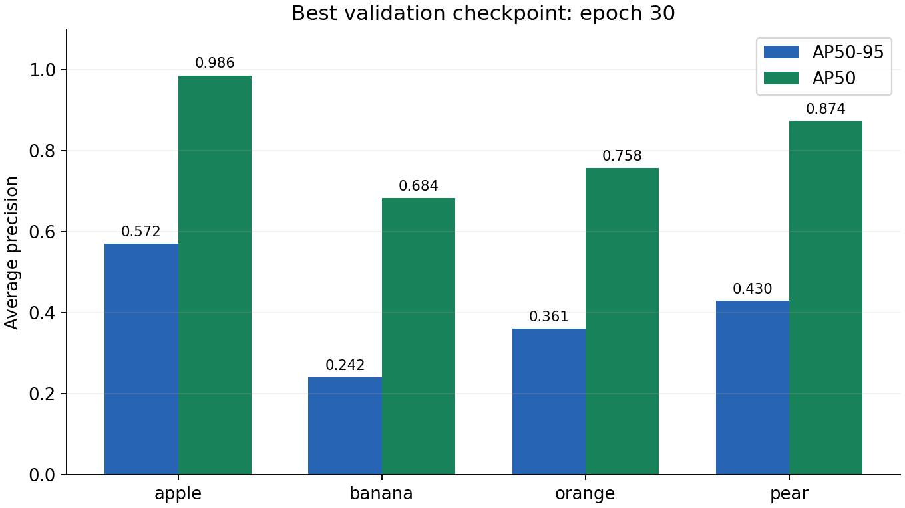
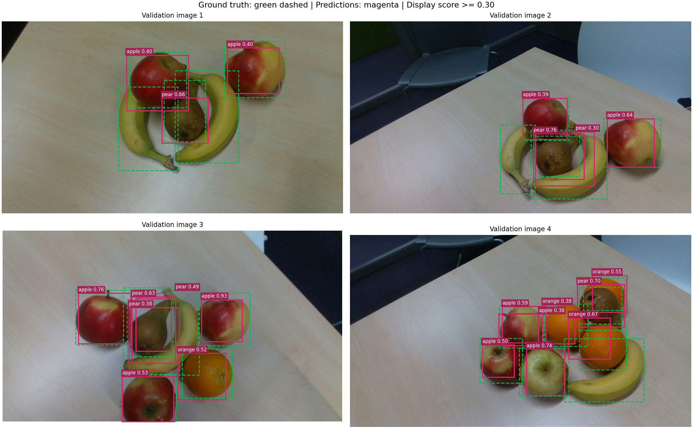
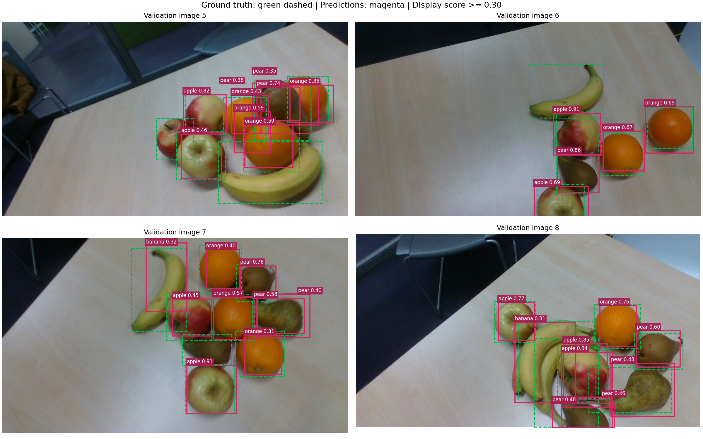
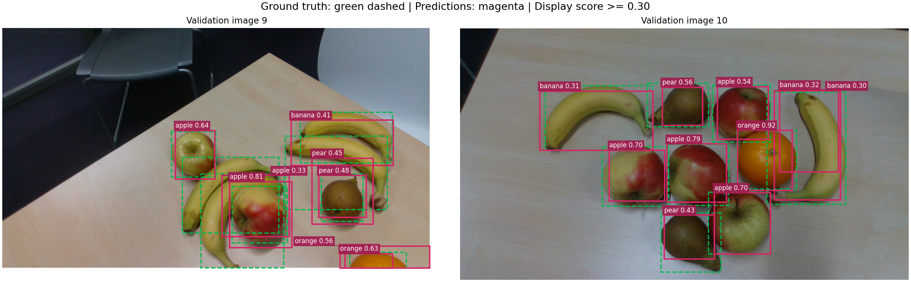

# Validation Results: Seed 42, CPU

This report records one complete training run of the two-head ResNet-18 fruit detector. The backbone starts from official TorchVision pretrained weights; both the backbone and prediction heads are trained. The model has 13,612,754 trainable parameters.

## Experiment

| Setting | Value |
| --- | --- |
| Training split | 218 images, 1,603 objects |
| Validation split | 10 images, 72 objects |
| Input / batch size | 512 x 512 / 4 |
| Epochs / seed | 30 / 42 |
| Selected checkpoint | Epoch 30, highest validation mAP50-95 |
| Optimizer | AdamW; backbone LR 0.00001, head LR 0.0001 |
| Weight decay | 0.0001 |
| Training and per-epoch validation time | 2,129 seconds, approximately 35.5 minutes |
| Device | CPU, 6 PyTorch threads |

The notebook was executed from top to bottom. After training, the saved best checkpoint was loaded again and its validation mAP was verified against the recorded epoch. The optional test export was skipped because no `test.json` was available; no independent test score is reported.

## Measured Scores

| Metric | Value |
| --- | ---: |
| mAP50-95 | 0.4012 |
| mAP50 | 0.8255 |
| mAP75 | 0.3206 |

AP is computed with TorchMetrics and pycocotools. Evaluation uses normalized center-format boxes, confidence above 0.05, class-wise NMS at IoU 0.70, and a maximum of 100 detections per image for the reported AP. mAP50-95 averages IoU thresholds 0.50 through 0.95 in steps of 0.05. Missed images remain in evaluation; predictions on background images count as false positives.

| Class | Training objects | Validation objects | AP50-95 | AP50 |
| --- | ---: | ---: | ---: | ---: |
| Apple | 403 | 25 | 0.5715 | 0.9865 |
| Banana | 290 | 17 | 0.2420 | 0.6835 |
| Orange | 472 | 15 | 0.3609 | 0.7575 |
| Pear | 438 | 15 | 0.4304 | 0.8744 |





The mean batch loss decreased from 7.000 to 1.723. The gap between mAP50 and the stricter metrics indicates that bounding-box localization remains a major limitation. Validation mAP50-95 was highest at the final epoch, so this run does not establish that training has fully converged.

## All Validation Images

All 10 images are shown in their original validation order, without selecting only successful examples. Green dashed boxes are ground truth; magenta boxes are predictions with class names and confidence scores. The fixed display threshold is 0.30. Lower-confidence detections used by the evaluator are omitted from these figures for readability, so the gallery is not a direct visualization of every evaluated detection.







Several apples are localized well. Bananas often fall below the display threshold, and overlapping fruit can produce duplicate boxes or incorrect classes. The gallery preserves these errors. Validation photographs are reproduced with permission; the full dataset is not included.

## Environment and Reproduction

The recorded environment was Windows, Python 3.14.5, PyTorch 2.12.0 (CPU), TorchVision 0.27.0, TorchMetrics 1.9.0, pycocotools 2.0.11, NumPy 2.4.6, and Pillow 12.2.0. Exact resolved dependencies are in the repository's `uv.lock`.

After supplying a compatible dataset, run from the repository root:

```bash
uv sync --locked --python 3.14.5
uv run python scripts/run_notebook.py --output runs/reproduction
```

Use a new output directory for each run. The same seed does not guarantee identical numbers across Python versions, PyTorch builds, hardware, or different datasets.

The measured mean batch-one forward pass was 130.9 ms over nine validation images after excluding the first image. This small timing sample excludes image decoding, transforms, and NMS; it is not an end-to-end deployment benchmark.

Machine-readable artifacts:

- [Run summary and source fingerprints](summary.json)
- [Per-epoch training and validation history](history.json)

The summary includes dataset fingerprints, the checkpoint hash, the notebook code hash, and hashes of supporting source files. Text hashes use UTF-8 with LF line endings. Notebook markdown and metadata are excluded from the notebook code hash. Weights, raw predictions, and the executed notebook remain local.

## Limitations and Next Steps

- Only one seed and 10 validation images were evaluated. The validation set also selects the checkpoint, so these scores are not an unbiased test estimate.
- Exact training/validation image hashes do not overlap, and JSON/text validation annotations agree. Similar scenes or near-duplicate compositions may still occur across splits.
- No comparison with another detector or single-head ablation has been performed. The benefit of the second prediction head is not established by this run.
- Area-specific AP is not reported because evaluation uses normalized boxes.
- Future work should add a larger scene-separated test set, repeat multiple seeds, compare established detector baselines, and investigate duplicate detections and banana localization.

## Evaluation Corrections

The previous file-based evaluator skipped images without predictions and ignored predictions on images without ground truth. These cases now count as misses and false positives respectively, with regression tests. Historical scores from the old evaluator are not directly comparable.

The run also adds an explicit random seed, handles empty-target losses without NaNs, saves the first checkpoint even at zero AP, and reloads the best checkpoint for reporting. The model architecture, loss weights, learning rates, augmentation ranges, and 30-epoch training duration were retained.
