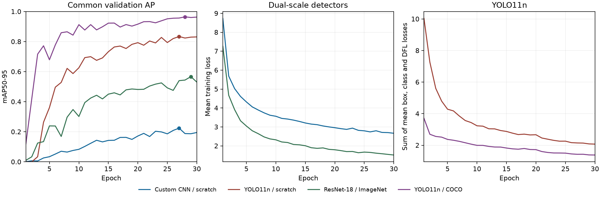
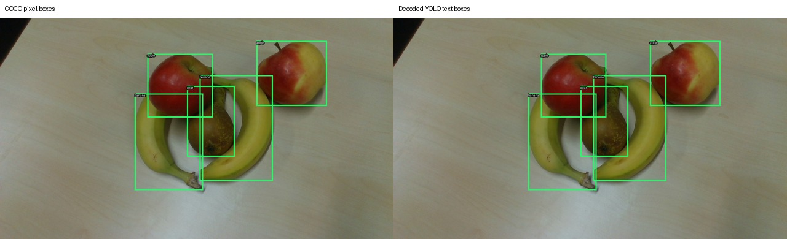

# Custom-Backbone Fruit Detector vs. YOLO11n

This study compares two detectors trained from random initialization on the same 218 fruit images. One uses a five-stage CNN designed for this project and two prediction heads inherited from the course detector. The other uses the official Ultralytics YOLO11n architecture and trainer. Two additional runs measure practical transfer learning with an ImageNet-pretrained ResNet-18 and a COCO-pretrained YOLO11n.

## Results

**YOLO11n trained from scratch reached 83.4% validation mAP50-95; the custom CNN reached 22.4%.** The custom detector had the faster forward pass. Both ran for 30 epochs. These scores describe ten images used for checkpoint selection, rather than an independent test set.

| Detector | Initialization | Selected epoch | mAP50-95 | mAP50 | mAP75 | Forward / end-to-end, median |
|---|---|---:|---:|---:|---:|---:|
| Custom CNN + dual-scale heads | Random | 27 | 22.4% | 45.0% | 21.4% | 3.75 / 22.97 ms |
| YOLO11n | Random | 27 | 83.4% | 99.5% | 91.8% | 8.83 / 25.63 ms |
| ResNet-18 + dual-scale heads | ImageNet | 29 | 56.7% | 96.4% | 65.3% | 7.45 / 26.93 ms |
| YOLO11n | COCO | 28 | 96.5% | 100.0% | 99.9% | 8.41 / 25.81 ms |

The gap between the scratch recipes was 61.0 percentage points. Orange was the strongest class for the custom CNN (56.3% AP), while banana (5.7%) and pear (3.3%) were often missed. Scratch YOLO reached 92.4%, 72.6% and 76.9% AP respectively. Holding the YOLO architecture and recipe fixed, COCO initialization added 13.1 points of mAP50-95 on this split. The ResNet-18 and custom runs share heads and losses, but differ in both backbone and initialization.

The custom CNN used 303 MiB peak allocated training memory versus 457 MiB for scratch YOLO, despite having more parameters (4.24M versus 2.59M). Its 5.08 ms forward advantage narrowed to 2.67 ms once PNG decoding, resizing, upload and postprocessing were included. All latencies were measured on one RTX 5070 Laptop GPU using the same ten images, batch one, unfused FP32 models, TF32 disabled, ten warm-ups and fifty synchronized trials per scope. Small differences between the two YOLO timings are not evidence of a speed effect from pretraining. [Per-class AP, training time, memory, latency percentiles and all ten images](measurements.md)

Dots mark the selected checkpoints. Losses are plotted within detector families because their objectives use different scales.

## What the models missed

At the fixed display threshold of 0.30 and matching IoU of 0.50, the custom CNN matched 15 of 72 labeled fruit; scratch YOLO matched 70, ResNet-18 matched 66, and COCO-pretrained YOLO matched all 72. This threshold answers a different question from AP, which ranks detections retained above 0.05 over multiple IoUs. Even 100.0% mAP50 can coexist with lower-ranked false detections.

- [Image 8](val_08.jpg): scratch YOLO labeled the elongated pear at the lower right as a banana. COCO-pretrained YOLO recognized all eight fruit but also produced a duplicate. A wrong class counts as a missed ground truth when no correct prediction matches it.
- [Image 9](val_09.jpg): the custom model displayed no boxes for eight labeled fruit. Scratch YOLO found all eight, but added three duplicate boxes and two other false positives in a scene with overlapping bananas. Across all ten images, scratch YOLO produced six duplicate boxes after NMS.
- [Image 5](val_05.jpg): both YOLO models found all eight labeled fruit. Both also placed pear boxes against the left edge, outside the annotated fruit cluster. COCO-pretrained YOLO produced four unmatched boxes and one wrong-class prediction on this frame alone.

The [ordered gallery](measurements.md#paired-validation-gallery) shows the full set, including easier scenes. The [per-image diagnostic counts](display_errors.json) use the published display and matching rules; the [scored predictions](yolo11n-scratch/predictions.json) retain the lower metric threshold.

## Dataset and protocol

The fixed split contains 218 training images with 1,603 objects and 10 validation images with 72 objects. The class counts (train / validation) are apple 403 / 25, banana 290 / 17, orange 472 / 15 and pear 438 / 15. Image hashes and annotation hashes match the recorded CPU experiment, and the two splits have zero exact image-file overlap. The validation photos here are reproduced with permission. The full course data remains local.

The conversion tool maps COCO IDs 1 through 4 to YOLO IDs 0 through 3 in the class order above. It validates each image and box, checks validation JSON against the course text labels, writes normalized center-format labels, and decodes them back to original-image pixels. The largest coordinate discrepancy across 1,675 boxes was under 0.000001 pixel. The left panel below uses the original COCO data and the right panel uses the parsed YOLO text.

Each run uses seed 42, 30 epochs, 512 by 512 inputs, batch size four, one optimizer step per batch, and CUDA FP16 mixed-precision training. The final short batch has two images. For every epoch, the common evaluator processes all ten images at batch size one in FP32. A candidate survives at confidence strictly above 0.05. Original-pixel boxes are clipped to the image and zero-area boxes are dropped. Class-wise NMS uses IoU 0.70. The top 100 surviving scores across classes are kept per image. TorchMetrics with pycocotools computes COCO AP over IoU thresholds 0.50 to 0.95. Empty predictions and false positives on background images are included. Each run saves the earliest maximum validation mAP50-95 and reloads it to verify mAP50-95, mAP50, mAP75 and every per-class AP.

## Architectures

**Custom CNN.** Each stage has a stride-two 3×3 convolution, a depthwise 3×3 convolution for spatial refinement, then a 1×1 convolution for channel mixing. Each convolution is followed by BatchNorm and SiLU. Narrow early stages limit the cost at high resolution. The last two stages produce the channel counts expected by the original heads, so the detector can reuse both heads directly.

| Stage | Channels | Output at 512 px | Input stride | Parameters |
|---|---:|---:|---:|---:|
| 1 | 24 | 256 × 256 | 2 | 1,584 |
| 2 | 48 | 128 × 128 | 4 | 13,392 |
| 3 | 96 | 64 × 64 | 8 | 52,128 |
| 4, fine head input | 256 | 32 × 32 | 16 | 290,560 |
| 5, coarse head input | 512 | 16 × 16 | 32 | 1,449,472 |

The custom backbone has 1,807,136 parameters and the two heads have 2,436,242. The full detector has **4,243,378** parameters. A stride-two convolution in each head produces a 16 × 16 or 8 × 8 output grid, for 320 candidate boxes per image. Each candidate predicts center offsets, dimensions, four class logits and objectness. Inference scores each class with objectness times softmax class probability.

**ResNet-18 reference.** The original detector uses TorchVision ResNet-18 with ImageNet-1K initialization, feature maps at strides 16 and 32, and the same dual-scale heads. The full detector has **13,612,754** parameters. Both the backbone and heads are fine-tuned.

**YOLO11n.** Both YOLO runs use Ultralytics 8.3.253 and a four-class detection head on three feature scales (strides 8, 16, 32). The architecture produces 5,376 spatial candidates per 512-square image. Box regression uses distribution focal loss alongside box and classification objectives. The scratch run constructs the model from YAML. The transfer run loaded 448 of 499 state entries from the official COCO checkpoint into the four-class model. Ultralytics' separate AMP compatibility probe uses its stock model; the scratch training model receives random weights. [Official YOLO11 model documentation](https://docs.ultralytics.com/models/yolo11/) · [Pinned implementation](https://github.com/ultralytics/ultralytics/tree/v8.3.253)

## Training and inference

| Setting | Dual-scale detectors | YOLO11n detectors |
|---|---|---|
| Geometry | Stretch to 512-square at validation | Preserve aspect ratio and pad to 512-square with value 114 |
| Pixel transform | RGB / 255 | RGB / 255 |
| Augmentation | Centered scale jitter 0.8–1.2, crop or pad, horizontal flip 0.5, brightness/contrast/saturation ±0.2, hue ±0.05 | Mosaic through epoch 20, translation 0.1, scale 0.5, horizontal flip 0.5, HSV gains 0.015/0.7/0.4 |
| Optimizer | AdamW, backbone LR 0.00001, heads LR 0.0001, weight decay 0.0001 | AdamW, LR 0.001, beta1 0.937, weight decay 0.0005, gradient-norm clip 10 |
| Schedule | ReduceLROnPlateau on common mAP, factor 0.5, patience 10 | Three warm-up epochs and linear decay to 1% of the initial LR |
| Assignment and objectives | Hungarian class/L1/GIoU matching; CE + 5 L1 + 5 DIoU + 2 objectness BCE | Ultralytics task-aligned assignment; box 7.5, classification 0.5 and DFL 1.5 |
| Validation weights | Trained FP32 parameters | FP32 exponential moving average |

For the dual-scale GPU runs the convolutional forward pass uses autocast, and assignment and loss arithmetic use FP32 for numerical stability. Both backbones use the historical learning rates, including the small backbone LR for the randomly initialized CNN. YOLO retains its own training recipe with nominal batch four, so the upstream trainer also accumulates one batch per step. All effective Ultralytics arguments and the actual per-epoch learning rates are archived with the run.

To undo stretching, each axis scales independently from the input square to the source image. To undo letterboxing, the evaluator subtracts the actual integer padding and divides each axis by the corresponding rounded resize ratio. All four detectors then use the same score filtering, pixel-space NMS and AP implementation. The comparison measures complete detector recipes. Preprocessing, head design, assignment, augmentation, learning rates and EMA can all affect the result.

## Historical result

The preceding CPU run used the pretrained ResNet-18 detector and obtained **40.1% mAP50-95, 82.5% mAP50 and 32.1% mAP75** at epoch 30. Its original metrics and figures remain in [the CPU report](../seed42-cpu/README.md). The comparison table uses the four freshly evaluated GPU checkpoints. The archived CPU summary used the earlier normalized-coordinate export, different software and CPU arithmetic. The CPU checkpoint was recorded on another laptop and was unavailable for rescoring here.

As an independent check of the evaluation paths, the four new prediction sets were also exported in the historical text format and scored against the original validation text annotations. Overall mAP, AP50, AP75 and all four class APs agreed exactly with the pixel-coordinate evaluator for every model. [Machine-readable cross-check](evaluator_crosscheck.json)

## Limitations and next experiment

These ten tabletop photos contain only 15 to 25 instances per class. They were consulted at every epoch to select each checkpoint. Similar tables, lighting and fruit arrangements may occur across splits even though file hashes do not overlap. One seed gives no estimate of training variance. The fixed epoch budget also favors recipes that learn quickly: from epoch 20 to 30, scratch YOLO rose from 79.3% to 83.1% mAP50-95; the custom CNN rose from 17.2% to 19.5%, with a higher score at epoch 27. Those trajectories do not establish convergence.

For a follow-up, first reserve a separate, authorized test set grouped by capture session, with new scenes and fruit-free backgrounds. Freeze the current recipes and repeat the primary pair at two more seeds (for example, 43 and 44); report individual runs, mean and spread. A single predeclared 60-epoch comparison for both scratch models would then test whether the 30-epoch budget constrained the custom CNN. To isolate the backbone itself, compare the custom and ResNet-18 backbones **both from random initialization** under the same dual-scale recipe. None of these follow-ups was used to tune the reported scores.

## Reproduction and artifacts

The [reproduction commands](../../README.md#reproduce-the-gpu-comparison) cover the uv environment, data conversion, CUDA smoke test, training, benchmarking and figure export. The record for each model contains `config.json`, `provenance.json`, `history.json`, `summary.json`, `predictions.json` and `benchmark.json`. The provenance includes the source commit, LF-normalized source hashes, image and annotation fingerprints, software versions, GPU, CUDA and driver details. Selected weights remain in local `runs/` directories and are identified by SHA-256. The [complete measurement tables and gallery](measurements.md) include every validation image in COCO order at display confidence 0.30.

**CV description:** Designed a dual-scale fruit detector with a custom CNN backbone and benchmarked it against YOLO11n in four reproducible GPU experiments, measuring validation accuracy, inference latency, and detection errors.
