# GPU measurements

All scores use the reloaded checkpoint selected on the ten validation images. AP is shown as a percentage.

| Detector / initialization | Epoch | mAP50-95 | mAP50 | mAP75 | Apple AP | Banana AP | Orange AP | Pear AP |
|---|---:|---:|---:|---:|---:|---:|---:|---:|
| Custom CNN / scratch | 27 | 22.4 | 45.0 | 21.4 | 24.5 | 5.7 | 56.3 | 3.3 |
| YOLO11n / scratch | 27 | 83.4 | 99.5 | 91.8 | 91.8 | 72.6 | 92.4 | 76.9 |
| ResNet-18 / ImageNet | 29 | 56.7 | 96.4 | 65.3 | 70.2 | 31.2 | 67.1 | 58.3 |
| YOLO11n / COCO | 28 | 96.5 | 100.0 | 99.9 | 99.0 | 95.0 | 99.1 | 92.9 |

| Detector / initialization | Parameters | Train + validation (s) | Peak allocated (MiB) | Forward p50 / p90 (ms) | End-to-end p50 / p90 (ms) |
|---|---:|---:|---:|---:|---:|
| Custom CNN / scratch | 4,243,378 | 273.4 | 303 | 3.75 / 3.96 | 22.97 / 23.94 |
| YOLO11n / scratch | 2,590,620 | 316.0 | 457 | 8.83 / 9.76 | 25.63 / 26.78 |
| ResNet-18 / ImageNet | 13,612,754 | 293.5 | 462 | 7.45 / 8.01 | 26.93 / 27.75 |
| YOLO11n / COCO | 2,590,620 | 311.7 | 452 | 8.41 / 9.55 | 25.81 / 26.91 |

Training time includes all epochs and their validation passes. Peak memory is PyTorch allocated memory during that interval. Latency uses one 512-square FP32 image on the same GPU. Each scope gets 10 warm-ups and 50 synchronized samples. Forward starts with a resident tensor. End-to-end includes warm-filesystem PNG read/decode, preprocessing, upload, model, class-wise NMS, and CPU results.

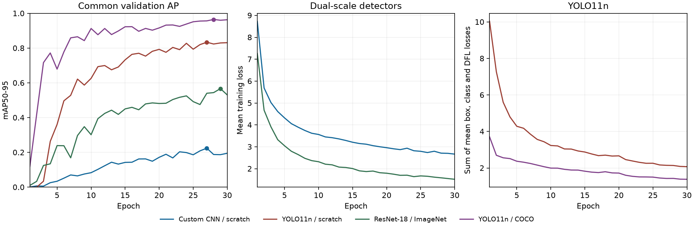

## Display-threshold diagnostics

| Detector / initialization | Correct | Missed GT | Wrong class | Duplicate | Other FP |
|---|---:|---:|---:|---:|---:|
| Custom CNN / scratch | 15 | 57 | 2 | 0 | 0 |
| YOLO11n / scratch | 70 | 2 | 1 | 6 | 4 |
| ResNet-18 / ImageNet | 66 | 6 | 0 | 5 | 0 |
| YOLO11n / COCO | 72 | 0 | 1 | 1 | 4 |

At score >= 0.30, match boxes in descending confidence order at IoU >= 0.50. Each ground truth can match once. An extra match to the same class is a duplicate. An overlap with only another class is a wrong-class prediction. Other false positives include poorly localized boxes. Misses count all unmatched ground truths, including those with only wrong-class predictions.

## Paired validation gallery

Every detector sees the same ten images in their original COCO order. The upper pair compares the two scratch models. The lower pair shows transfer learning. Each model's displayed boxes use its own scores at the same fixed threshold. Validation photos reproduced with permission.

### 01. color_001.png

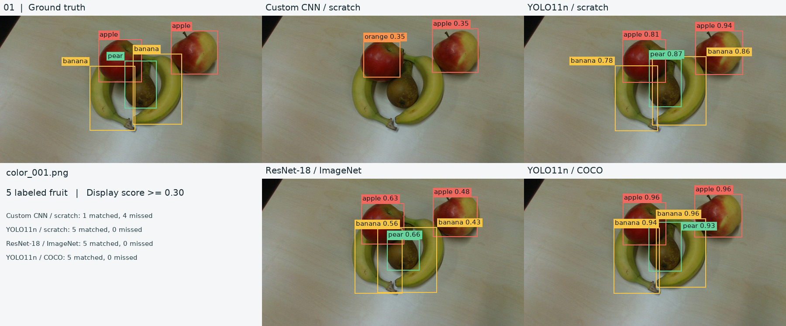

### 02. color_002.png

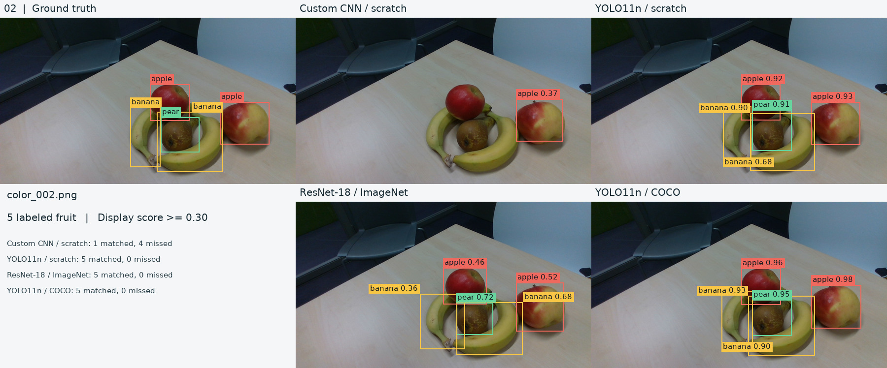

### 03. color_003.png

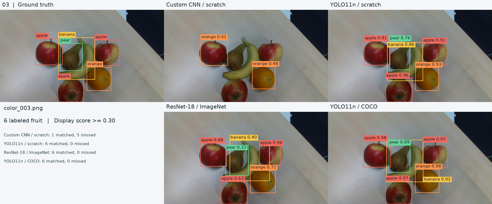

### 04. color_004.png

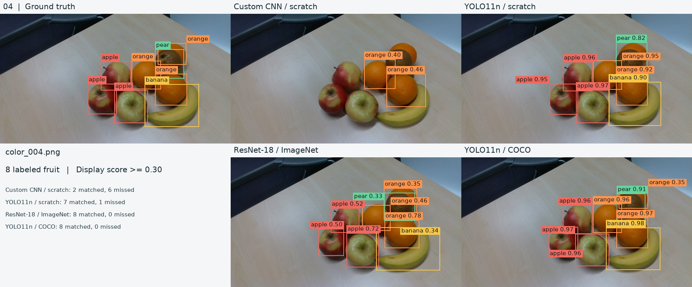

### 05. color_005.png

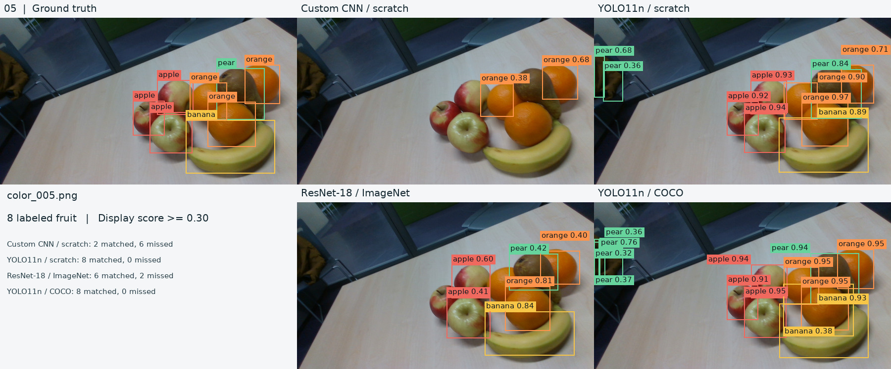

### 06. color_006.png

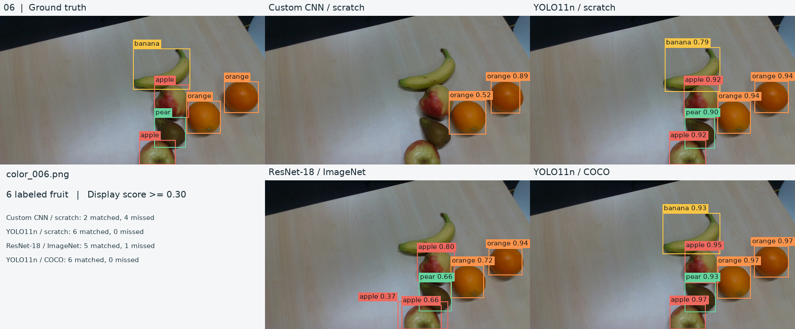

### 07. color_007.png

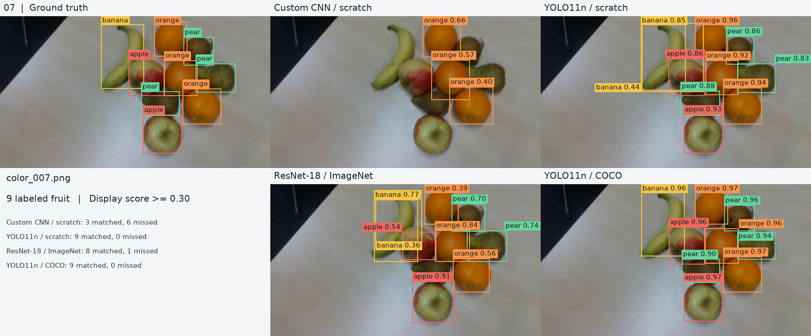

### 08. color_008.png

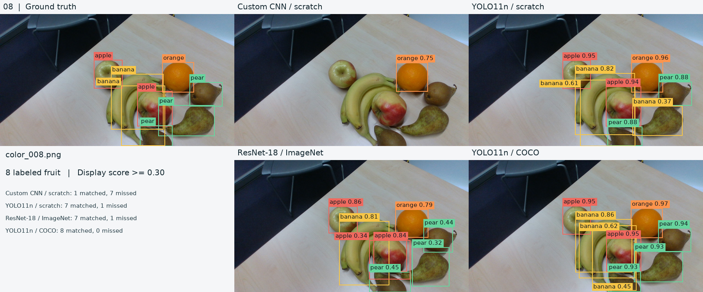

### 09. color_009.png

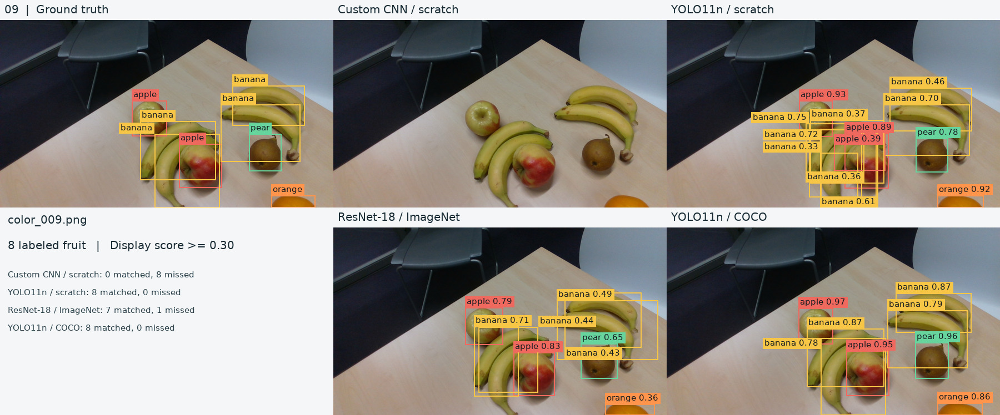

### 10. color_010.png

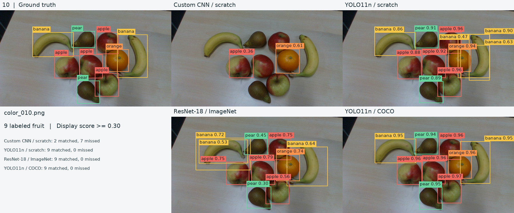
